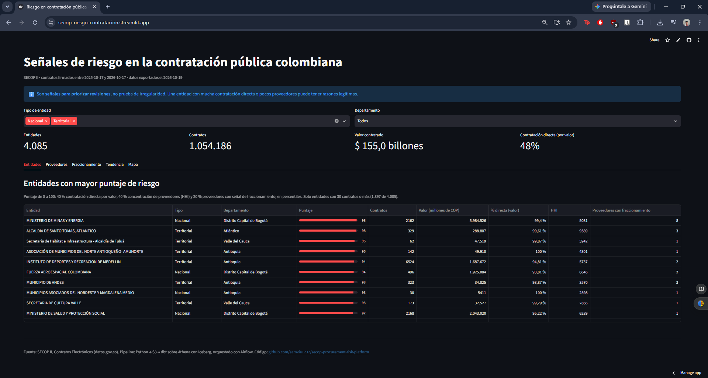
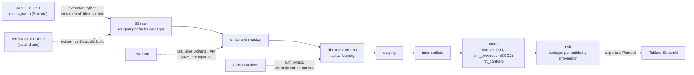
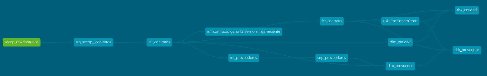
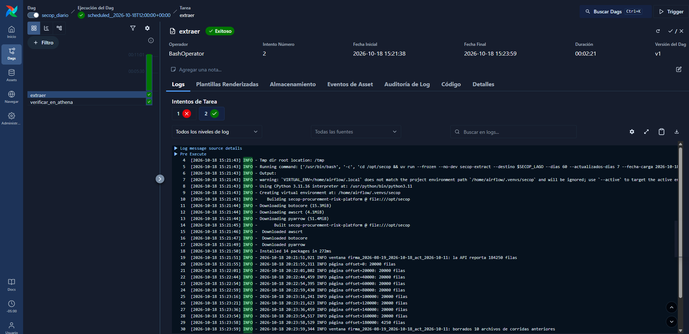
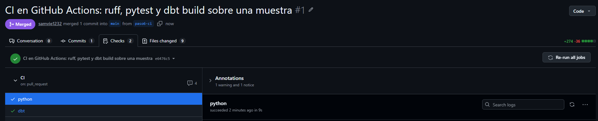

# Plataforma de riesgo en la contratación pública (SECOP II)

[](https://github.com/samvie1232/secop-procurement-risk-platform/actions/workflows/ci.yml)

*Read in English: [README.md](README.md)*

Plataforma de datos en AWS que ingiere a diario los contratos públicos de Colombia (SECOP II, 2,1 millones de contratos en dos años), los modela con dbt sobre Athena + Iceberg y prioriza entidades y proveedores por señales de riesgo: contratación directa, concentración de proveedores, fraccionamiento y proveedores nuevos que reciben contratos grandes.

- **Tablero en vivo:** https://secop-riesgo-contratacion.streamlit.app
- **Documentación y linaje de dbt:** https://samvie1232.github.io/secop-procurement-risk-platform/dbt/
- **Revisión manual de 5 alertas:** [docs/validacion_alertas.md](docs/validacion_alertas.md)
- **Señal de texto con Claude (en evaluación):** [docs/senal_texto.md](docs/senal_texto.md)

> Las señales de riesgo sirven para priorizar revisión. No son prueba de irregularidad.



## Arquitectura



| Capa | Herramienta | Qué hace |
| --- | --- | --- |
| Ingesta | Python (`src/secop_ingest`) | Pagina la API de Socrata por ventana de fechas y escribe Parquet en `s3://…/raw/contratos/fecha_carga=AAAA-MM-DD/`. |
| Almacenamiento y catálogo | S3, Glue Data Catalog | Tabla raw con partition projection; los modelos de dbt son tablas Iceberg. |
| Transformación | dbt-athena | staging → intermediate → marts → risk, pruebas de datos en todas las capas, una prueba unitaria y un snapshot SCD2. |
| Orquestación | Airflow 3 (Docker Compose, local) | DAG diario `extraer → verificar en Athena → dbt build`, con reintentos y avisos de falla por correo vía SNS. |
| Infraestructura | Terraform | Buckets, bases de Glue, workgroup de Athena con límite de escaneo, IAM, SNS y presupuesto de USD 5. |
| CI | GitHub Actions | Cada pull request corre ruff, pytest y un `dbt build` completo contra Athena sobre una muestra. |
| Tablero | Streamlit Community Cloud | Lee Parquet pequeños guardados en el repo; no necesita acceso a AWS. |

Linaje de dbt, de la tabla raw a los modelos de riesgo ([versión interactiva](https://samvie1232.github.io/secop-procurement-risk-platform/dbt/)):



## Cómo funciona

**Ingesta idempotente.** La fuente no tiene un campo confiable de cambios (`ultima_actualizacion` está vacía en el 38 % de las filas), así que la carga diaria trae los contratos firmados en los últimos 60 días más los actualizados en los últimos 7, y una carga semanal recarga los dos años completos. Cada corrida escribe primero sus archivos y solo después borra los que dejaron corridas anteriores de la misma ventana y fecha de carga. Repetir un día reemplaza sus datos en vez de duplicarlos.

**Merge en Iceberg.** `int_contratos` es un modelo incremental de dbt que hace merge por `id_contrato`. Una versión más nueva de un contrato reemplaza a la anterior y una más vieja nunca pisa a una más nueva. El modelo solo lee las particiones de raw posteriores a su última carga, y eso mantiene barata la corrida diaria. Iceberg es lo que lo hace posible sobre S3: actualizaciones por fila (merge), evolución de esquema y *time travel*, que Parquet solo no ofrece.

**Snapshot SCD2.** `snp_proveedores` registra cada cambio en el nombre, tipo de documento o condición de pyme de un proveedor. `dim_proveedor` guarda todas las versiones con `vigente_desde` y `vigente_hasta`, así un contrato se puede leer con los datos del proveedor que eran ciertos cuando se firmó.

**Contrato de datos.** [docs/data_contract.md](docs/data_contract.md) fija el dataset, la llave, los tipos y la estrategia incremental. Las columnas con datos personales (representantes legales, supervisores, cuentas bancarias) nunca se descargan.

## Indicadores de riesgo

Se calculan sobre los últimos 365 días con datos (del 2025-10-17 al 2026-10-17 en la exportación actual).

| Indicador | Nivel | Regla |
| --- | --- | --- |
| % de contratación directa | Entidad | Parte del valor contratado sin competencia. |
| Concentración de proveedores (HHI) | Entidad | Índice Herfindahl-Hirschman del valor por proveedor: 10.000 significa que un solo proveedor se lleva todo. |
| Fraccionamiento | Entidad-proveedor | 3 o más contratos directos de la misma pareja en 30 días. |
| Proveedor nuevo con contratos grandes | Proveedor | Contratos dentro del 5 % de mayor valor en sus primeros 90 días en SECOP II. |
| Señal de texto (en evaluación) | Contrato | Claude (Amazon Bedrock) lee el objeto, la descripción y la justificación de los contratos que ya marcan los indicadores anteriores y devuelve nivel, tipo de señal y una cita textual verificada. Todavía no entra al puntaje. Detalle: [docs/senal_texto.md](docs/senal_texto.md). |
| Puntaje compuesto (0-100) | Entidad y proveedor | Percentiles ponderados: entidad 40 % directa, 40 % HHI, 20 % fraccionamiento; proveedor 50 % nuevo con contratos grandes, 30 % fraccionamiento, 20 % directa. Las entidades con menos de 30 contratos no se puntúan. |

**Resultados de la exportación actual**

- 1.071.772 contratos de 4.147 entidades en el periodo de análisis; 1.928 entidades tienen contratos suficientes para puntuarse.
- En los dos años, el 77 % de los contratos (55 % del valor) fueron de contratación directa: 82 % de los contratos en el orden nacional y 75 % en el territorial.
- 1.485 parejas entidad-proveedor de 397 entidades muestran la señal de fraccionamiento.
- Las cinco entidades con mayor puntaje se revisaron a mano en SECOP II: cuatro se explican por un solo contrato muy grande con otra entidad pública o un proveedor único, y una es un error de digitación en la fuente (un contrato publicado con un valor mil veces mayor que el de su proceso). Detalle y mejoras que salen de ahí: [docs/validacion_alertas.md](docs/validacion_alertas.md).

## Orquestación con Airflow

El DAG `secop_diario` corre todos los días a las 7:00 (hora de Colombia) en Airflow 3 con Docker Compose. Una corrida completa tarda unos 4 minutos: extracción, verificación en Athena de que la partición del día no quedó vacía y `dbt build`.



La captura muestra la idempotencia en acción: el primer intento falló, Airflow lo reintentó solo, y el segundo bajó los 184.250 contratos de la ventana y luego borró los 10 archivos que habían dejado corridas anteriores de esa misma ventana y fecha de carga.

## CI en cada pull request

`main` está protegida: solo acepta cambios por pull request y con los dos checks de GitHub Actions en verde.

- **python**: `ruff check`, `ruff format --check` y `pytest`, sin tocar AWS.
- **dbt**: `dbt build` completo contra Athena (modelos, snapshot, pruebas de datos y la prueba unitaria de deduplicación) sobre una muestra: la última partición de raw y los contratos firmados en sus últimos 30 días. Construye en una base aparte (`secop_ci`), así un PR nunca escribe en `secop_analytics`. Tarda cerca de un minuto y cuesta fracciones de centavo.



El CI entra a AWS con un usuario IAM cuya política solo permite leer `raw/` y escribir en `secop_ci`; la llave vive únicamente en los secretos del repositorio. Lo ideal sería OIDC (credenciales temporales sin llaves), pero la organización de AWS de esta cuenta lo prohíbe con una SCP. En una cuenta sin esa restricción, el cambio es reemplazar el usuario por un rol y una línea del workflow.

## Costo

| Control | Cómo |
| --- | --- |
| Nada encendido todo el tiempo | Airflow corre local en Docker en vez de MWAA (cientos de dólares al mes). Athena y Glue cobran por uso. |
| Límite de escaneo en Athena | El workgroup `secop` corta cualquier consulta que escanee más de 5 GB. |
| Consultas baratas | Parquet e Iceberg particionados por fecha; los modelos incrementales solo leen particiones nuevas. |
| Presupuesto | Presupuesto mensual de USD 5 con alertas por correo, creado con Terraform el primer día. |
| Tablero gratis | Streamlit lee Parquet del repo: no cuesta nada y sigue vivo después de `terraform destroy`. |

**Costo medido hasta ahora (2026-10-17 a 2026-10-19):** 983 consultas de Athena escanearon 6,45 GB en total (unos USD 0,04 a USD 5 por TB, contando el mínimo de 10 MB por consulta), y el lake ocupa 1,18 GB en S3 (unos USD 0,03 al mes). Toda la construcción, incluida la carga histórica de dos años, cada corrida de dbt y cada corrida del CI, costó **menos de USD 0,10**. AWS aún no había publicado el valor facturado cuando se escribió esto; las cifras salen del historial de consultas de Athena y del tamaño de los buckets.

## Cómo reproducirlo

Requisitos: cuenta y CLI de AWS, Terraform 1.16, Docker, [uv](https://docs.astral.sh/uv/) y Python 3.11.

```bash
# 1. Infraestructura (primero el bucket del state, luego todo lo demás)
cd infra/bootstrap && terraform init && terraform apply
cd ../terraform && cp terraform.tfvars.example terraform.tfvars   # pon tu correo de alertas
terraform init && terraform apply

# 2. Carga histórica de dos años (unos 2,1 millones de contratos)
cd ../.. && uv sync
uv run secop-extract --destino s3://<bucket-lake>/raw --desde 2024-10-01 --hasta <hoy> --por-mes

# 3. Modelos y pruebas
uv run --group dbt dbt build --project-dir dbt --profiles-dir dbt

# 4. Orquestación diaria (interfaz de Airflow en http://localhost:8080)
cd airflow && cp .env.example .env   # llena AIRFLOW_JWT_SECRET y las salidas de Terraform
docker compose up -d

# 5. Tablero
AWS_PROFILE=<perfil> uv run python tablero/exportar.py
pip install -r tablero/requirements.txt && streamlit run tablero/app.py
```

Los nombres de los buckets incluyen el id de la cuenta de AWS: cámbialo en `infra/terraform/versions.tf`, `dbt/profiles.yml` y `airflow/.env`. `terraform destroy` borra todo menos el bucket del state.

## Limitaciones

- **Señales, no pruebas.** La contratación directa es legal para muchos fines (por ejemplo, prestación de servicios), y un HHI alto puede reflejar un único proveedor legítimo, como una empresa de servicios públicos o un fabricante exclusivo. La revisión manual muestra con qué frecuencia pasa.
- **El fraccionamiento** solo mide la repetición. El brief pedía contratos "justo bajo un tope", pero los topes dependen del presupuesto de cada entidad y SECOP no los publica.
- **Los proveedores nuevos** se aproximan por su primera aparición en SECOP II, porque la fuente no trae fecha de creación de la empresa. Solo cuentan como nuevos los que aparecen seis meses después del inicio de la historia cargada.
- **Las adiciones desproporcionadas** (valor adicionado mayor al 50 % del inicial) no están implementadas: el dataset de contratos no trae el valor adicionado, solo los días. Hace falta el dataset de modificaciones de SECOP II.
- **Calidad de datos:** 66.711 contratos no tienen fecha de firma ni de actualización y quedan por fuera; los valores por encima de 100 billones de pesos se tratan como errores de digitación; la cobertura de SECOP II para entidades nacionales es incompleta antes de 2020.
- **Vigencia del tablero:** muestra la última exportación, no datos en vivo.

## Hoja de ruta

- Indicador de adiciones con el dataset de modificaciones de SECOP II.
- Backfill desde 2020-08 para comparar entidades nacionales entre gobiernos, con tasas y no con conteos.
- Validación del contrato de datos en la ingesta y alertas a Slack.
- Airflow en la nube y un modelo de anomalías no supervisado.

## Licencia

MIT
