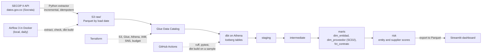

# SECOP II Procurement Risk Platform

[](https://github.com/samvie1232/secop-procurement-risk-platform/actions/workflows/ci.yml)

*Leer en español: [README.es.md](README.es.md)*

A daily data platform on AWS that ingests Colombia's public procurement contracts (SECOP II, 2.1 million contracts over two years), models them with dbt on Athena + Iceberg, and ranks public entities and suppliers by procurement risk signals: direct awards, supplier concentration, contract splitting and new suppliers that win large contracts.

- **Live dashboard:** https://secop-riesgo-contratacion.streamlit.app
- **dbt docs and lineage:** https://samvie1232.github.io/secop-procurement-risk-platform/dbt/
- **Manual review of 5 alerts:** [docs/validacion_alertas.md](docs/validacion_alertas.md)

> Risk signals are a way to prioritize review. They are not evidence of wrongdoing.


## Architecture



| Layer | Tool | What it does |
| --- | --- | --- |
| Ingestion | Python (`src/secop_ingest`) | Pages through the Socrata API by date window, writes Parquet to `s3://…/raw/contratos/fecha_carga=YYYY-MM-DD/`. |
| Storage and catalog | S3, Glue Data Catalog | Raw table with partition projection; dbt models as Iceberg tables. |
| Transformation | dbt-athena | staging → intermediate → marts → risk, data tests on every layer, a unit test and an SCD2 snapshot. |
| Orchestration | Airflow 3 (Docker Compose, local) | Daily DAG `extract → verify in Athena → dbt build`, retries and failure emails through SNS. |
| Infrastructure | Terraform | Buckets, Glue databases, Athena workgroup with a scan limit, IAM, SNS and a USD 5 budget. |
| CI | GitHub Actions | Every pull request runs ruff, pytest and a full `dbt build` against Athena on a sample. |
| Dashboard | Streamlit Community Cloud | Reads small Parquet exports from the repo; no AWS access needed. |

dbt lineage, from the raw table to the risk models ([interactive version](https://samvie1232.github.io/secop-procurement-risk-platform/dbt/)):


## How it works

**Idempotent ingestion.** The source has no reliable change field (`ultima_actualizacion` is empty in 38 % of rows), so the daily run reloads contracts signed in the last 60 days plus those updated in the last 7, and a weekly job reloads the full two years. Each run writes its files first and only then deletes files that earlier runs left for the same window and load date. Re-running a day replaces its data instead of duplicating it.

**Iceberg merge.** `int_contratos` is an incremental dbt model that merges by `id_contrato`. A newer version of a contract replaces the old one, and an older one never overwrites a newer one. The model only reads raw partitions newer than its last load, which keeps the daily run cheap. Iceberg is what makes this possible on S3: row-level updates (merge), schema evolution and time travel, none of which plain Parquet offers.

**SCD2 snapshot.** `snp_proveedores` records every change to a supplier's name, document type or SME status. `dim_proveedor` keeps every version with `vigente_desde`/`vigente_hasta`, so a contract can be read against the supplier data that was true when it was signed.

**Data contract.** [docs/data_contract.md](docs/data_contract.md) fixes the dataset, key, types and incremental strategy. Columns with personal data (legal representatives, supervisors, bank accounts) are never downloaded.

## Risk indicators

Computed over the last 365 days of data (2025-10-17 to 2026-10-17 in the current export).

| Indicator | Level | Rule |
| --- | --- | --- |
| Direct award share | Entity | Share of contract value awarded without competition. |
| Supplier concentration (HHI) | Entity | Herfindahl-Hirschman index of contract value by supplier: 10,000 means one supplier gets everything. |
| Contract splitting | Entity-supplier | 3 or more direct contracts between the same pair within 30 days. |
| New supplier with large contracts | Supplier | Contracts in the top 5 % by value during the supplier's first 90 days in SECOP II. |
| Composite score (0-100) | Entity and supplier | Weighted percentiles: entity 40 % direct award, 40 % HHI, 20 % splitting; supplier 50 % new with large contracts, 30 % splitting, 20 % direct award. Entities with fewer than 30 contracts are not scored. |

**Results in the current export**

- 1,071,772 contracts from 4,147 entities in the analysis period; 1,928 entities have enough contracts to be scored.
- Over the two years, 77 % of contracts (55 % of value) were direct awards: 82 % of contracts at national level and 75 % at territorial level.
- 1,485 entity-supplier pairs from 397 entities show the contract-splitting signal.
- The five highest-scoring entities were reviewed by hand in SECOP II: four are explained by a single very large contract with another public body or a sole supplier, and one is a data-entry error at the source (a contract published at 1,000 times its tender value). Details and the improvements this suggests: [docs/validacion_alertas.md](docs/validacion_alertas.md).

## Orchestration with Airflow

The `secop_diario` DAG runs every day at 7:00 (Colombia time) in Airflow 3 with Docker Compose. A full run takes about 4 minutes: extraction, a check in Athena that the day's partition is not empty, and `dbt build`.


The screenshot shows idempotency at work: the first try failed, Airflow retried it, and the second try loaded 184,250 contracts and then deleted the 10 files earlier runs had left for that same window and load date.

## CI on every pull request

`main` is protected: changes only go in through pull requests with both GitHub Actions checks green.

- **python**: `ruff check`, `ruff format --check` and `pytest`, without touching AWS.
- **dbt**: a full `dbt build` against Athena (models, snapshot, data tests and the deduplication unit test) on a sample: the latest raw partition and contracts signed in its last 30 days. It builds into a separate database (`secop_ci`), so a pull request never writes to `secop_analytics`. It takes about a minute and costs a fraction of a cent.


CI signs in to AWS as an IAM user whose policy only allows reading `raw/` and writing to `secop_ci`; its key lives only in the repository secrets. OIDC (short-lived credentials, no keys) would be better, but this account's AWS organization blocks it with an SCP. In an account without that restriction, the change is replacing the user with a role and one line of the workflow.

## Cost

| Control | How |
| --- | --- |
| No always-on compute | Airflow runs locally in Docker instead of MWAA (hundreds of dollars a month). Athena and Glue are pay-per-use. |
| Athena scan limit | The `secop` workgroup stops any query that scans more than 5 GB. |
| Cheap queries | Parquet and Iceberg partitioned by date; incremental models read only new partitions. |
| Budget | USD 5 monthly budget with email alerts, created by Terraform on day one. |
| Free dashboard | Streamlit reads Parquet from the repo, so it costs nothing and survives `terraform destroy`. |

**Measured cost so far (2026-10-17 to 2026-10-19):** 983 Athena queries scanned 6.45 GB in total (about USD 0.04 at USD 5 per TB, including the 10 MB minimum per query), and the lake takes 1.18 GB in S3 (about USD 0.03 a month). The whole build, including the two-year backfill, every dbt run and every CI run, cost **under USD 0.10**. AWS had not yet published the billed amount when this was written; the figures come from the Athena query history and the bucket sizes.

## Reproduce it

Requirements: AWS account and CLI, Terraform 1.16, Docker, [uv](https://docs.astral.sh/uv/) and Python 3.11.

```bash
# 1. Infrastructure (state bucket first, then everything else)
cd infra/bootstrap && terraform init && terraform apply
cd ../terraform && cp terraform.tfvars.example terraform.tfvars   # set your alert email
terraform init && terraform apply

# 2. Two-year backfill (about 2.1 million contracts)
cd ../.. && uv sync
uv run secop-extract --destino s3://<lake-bucket>/raw --desde 2024-10-01 --hasta <today> --por-mes

# 3. Models and tests
uv run --group dbt dbt build --project-dir dbt --profiles-dir dbt

# 4. Daily orchestration (Airflow UI at http://localhost:8080)
cd airflow && cp .env.example .env   # fill in AIRFLOW_JWT_SECRET and your outputs
docker compose up -d

# 5. Dashboard
AWS_PROFILE=<profile> uv run python tablero/exportar.py
pip install -r tablero/requirements.txt && streamlit run tablero/app.py
```

Bucket names include the AWS account id: change it in `infra/terraform/versions.tf`, `dbt/profiles.yml` and `airflow/.env`. `terraform destroy` removes everything except the state bucket.

## Limitations

- **Signals, not proof.** Direct awards are legal for many purposes (for example personal service contracts), and a high HHI can reflect a single legitimate provider such as a utility or a sole manufacturer. The manual review shows how often that happens.
- **Contract splitting** only measures repetition. The brief asked for contracts "just below a threshold", but thresholds depend on each entity's budget and SECOP does not publish them.
- **New suppliers** are approximated by their first appearance in SECOP II, since the source has no company registration date. Only suppliers first seen six months after the start of the loaded history count as new.
- **Disproportionate additions** (added value above 50 % of the initial value) are not implemented: the contracts dataset has no added value, only added days. It needs SECOP II's modifications dataset.
- **Data quality:** 66,711 contracts have neither signature nor update date and are left out; values above COP 100 trillion are treated as typos; SECOP II coverage of national entities is incomplete before 2020.
- **Freshness of the dashboard:** it shows the last export, not live data.

## Roadmap

- Additions indicator from the SECOP II modifications dataset.
- Backfill from 2020-08 to compare national entities across administrations, using rates instead of counts.
- Data contract validation at ingestion and Slack alerts.
- Airflow in the cloud and an unsupervised anomaly model.

## License

MIT
