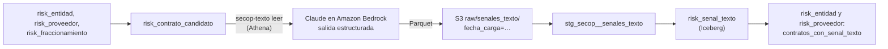

# Señal de texto: lectura de los contratos con Claude

Quinto indicador de la plataforma. Lee el texto libre de los contratos que ya marcan los otros cuatro indicadores y dice si el texto agrega una razón para revisarlos.

> Son **señales de riesgo para revisión humana**, no un detector de fraude. Una bandera dice "vale la pena que alguien lea este contrato", nunca "aquí hubo una irregularidad".

## Qué lee y qué devuelve

**Qué contratos.** Solo los de [`risk_contrato_candidato`](../dbt/models/risk/risk_contrato_candidato.sql): contratos del periodo de análisis que ya tienen al menos un motivo.

| Motivo | Regla |
| --- | --- |
| Fraccionamiento | Contrato directo de una pareja entidad-proveedor con la señal de fraccionamiento. |
| Proveedor nuevo | Contrato de un proveedor nuevo con contratos grandes, firmado en sus primeros 90 días. |
| Entidad con puntaje alto | Contrato directo de una entidad con puntaje de riesgo de 90 o más (`texto_puntaje_entidad_min`). |

Se leen primero los que tienen más motivos y, entre ellos, los de mayor valor.

**Qué texto.** Tres campos de SECOP II: `objeto_del_contrato`, `descripcion_del_proceso` y `justificacion_modalidad`, junto con el contexto (entidad, modalidad, valor, duración, motivos). El nombre del proveedor solo se envía si es una empresa (NIT).

**Qué devuelve.** Una respuesta JSON con esquema fijo (salida estructurada de la API):

| Campo | Contenido |
| --- | --- |
| `nivel` | `ninguno`, `bajo`, `medio` o `alto`. |
| `tipos` | Señales encontradas: justificación ausente o genérica, objeto vago, valor desproporcionado, objeto ajeno a la entidad, posible división del objeto, urgencia sin sustento, texto inconsistente. |
| `cita` | Fragmento copiado literalmente del contrato que sustenta la señal. |
| `explicacion` | Una o dos frases. |

**La bandera** (`bandera = true`) exige nivel medio o alto **y** que la cita esté de verdad en el contrato. La cita se busca en los tres campos ignorando mayúsculas, tildes y espacios. Si Claude cita algo que no está, la lectura se guarda pero la bandera queda en falso (`cita_verificada = false`), para poder medir cuánto pasa.

El prompt le dice explícitamente qué **no** es una señal por sí solo: la prestación de servicios con persona natural y objeto concreto, los convenios interadministrativos (4 de las 5 alertas de la [revisión manual](validacion_alertas.md) eran de este tipo), la mala redacción y el valor alto de un objeto que lo explica.

## Cómo fluye



- `secop-texto leer` escribe un Parquet por corrida en `raw/senales_texto/` (nunca reescribe lo anterior) y un CSV local en `revision/` con cada lectura junto al texto original.
- `risk_senal_texto` (Iceberg) se queda con la lectura más reciente sin error de cada contrato. Los contratos ya leídos con la misma versión del prompt (`VERSION_PROMPT`) no se vuelven a leer; un contrato con error sí se reintenta en la siguiente corrida.
- `risk_entidad` y `risk_proveedor` ganan dos columnas: `contratos_leidos_texto` y `contratos_con_senal_texto`. **No entran al puntaje compuesto** hasta que la evaluación muestre que la bandera es confiable.

## Cómo correrlo

Requisitos, una sola vez:

1. Habilitar el acceso al modelo en la consola de Amazon Bedrock (Model access) en `us-east-2`.
2. `terraform apply` en `infra/terraform`: crea la tabla `secop_raw.senales_texto` y da al rol del pipeline el permiso `bedrock-mantle:CreateInference`.
3. `uv sync` y `dbt build` para crear `risk_contrato_candidato` (y `risk_senal_texto`, vacía).

**Paso 1: prueba con 50 contratos.**

```bash
AWS_PROFILE=secop uv run secop-texto leer --destino s3://secop-risk-lake-<cuenta>/raw --limite 50
uv run --group dbt dbt build --project-dir dbt --profiles-dir dbt -s +risk_senal_texto+
```

Al final imprime cuántos quedaron con bandera, los niveles, cuántas citas no se encontraron, los errores, los tokens usados y la ruta del CSV de revisión. Abre ese CSV y mira si las banderas tienen sentido antes de leer más.

Opciones: `--modelo` (por defecto `anthropic.claude-opus-5-5`, o la variable `SECOP_MODELO`), `--region` (por defecto `us-east-2`), `--hilos` (llamadas en paralelo, 4) y `--releer` para volver a leer contratos ya leídos.

**Paso 2: etiquetar ~100 contratos a mano.**

```bash
AWS_PROFILE=secop uv run secop-texto muestra --n 100 --salida revision/etiquetas.csv
```

La muestra es estratificada: la mitad con bandera y la mitad sin bandera, con un `peso` por fila para que el recall represente a todos los contratos leídos. Para etiquetar, llena la columna `etiqueta_humana` con `si` o `no` leyendo el texto y, si hace falta, el proceso en SECOP II (`url_proceso`). **Pregunta guía: "¿leyendo el texto, este contrato merece que alguien lo revise más a fondo?"**. No es "¿hubo fraude?". Conviene etiquetar sin mirar las columnas `bandera`, `nivel` y `explicacion` (ocúltalas en Excel) para no sesgarse. La columna `nota` sirve para anotar el porqué.

**Paso 3: medir.**

```bash
uv run secop-texto evaluar revision/etiquetas.csv
```

Devuelve la matriz de confusión de la muestra y la precisión, el recall y el F1 ponderados. El recall se mide **entre los contratos candidatos**: dice cuántos de los que merecen revisión encuentra la lectura, no cuántos contratos irregulares hay en SECOP.

La carpeta `revision/` está en `.gitignore`: los CSV traen texto de contratos y no deben subirse.

## Costo

Cada contrato es una llamada de unos 2.000 tokens de entrada y unos cientos de salida (con esfuerzo bajo). El prompt de sistema se marca para caché. Con precios de referencia de la API de Anthropic para Claude Opus 5.5 (USD 4 por millón de tokens de entrada, USD 20 por millón de salida), un contrato cuesta del orden de 1 a 2 centavos de dólar: unos USD 1 los 50 de la prueba. Bedrock tiene su propia tabla de precios y el endpoint regional cobra un 10 % más que el global. `secop-texto leer` imprime los tokens usados para calcular el costo real.

El presupuesto de la cuenta es de USD 5 al mes, así que leer miles de contratos con Opus no cabe. Para volumen está `--modelo anthropic.claude-haiku-5-5`, mucho más barato; conviene compararlo con Opus sobre las mismas 100 etiquetas antes de cambiar.

## Limitaciones

- **Solo el texto que publica SECOP.** Muchos contratos traen objetos de una línea y justificaciones que solo citan la norma; eso ya es información, pero la lectura no ve los documentos del proceso.
- **No compara con otros contratos.** Cada contrato se lee solo: no sabe si el mismo objeto se copió en 40 contratos de la misma entidad. Eso es mejor hacerlo en SQL.
- **El modelo se equivoca.** Por eso la cita se verifica, la bandera no entra al puntaje y la evaluación es contra etiquetas humanas.

## Fase 2 (opcional): leer los PDF del proceso

`url_proceso` apunta a la página pública del proceso en SECOP II, donde están los estudios previos, la invitación y el contrato firmado. Leerlos daría mucho más contexto (presupuesto oficial, número de oferentes, justificación completa), pero antes hay que confirmar que el portal permite descargarlos de forma automatizada, a qué ritmo y bajo qué condiciones de uso.
